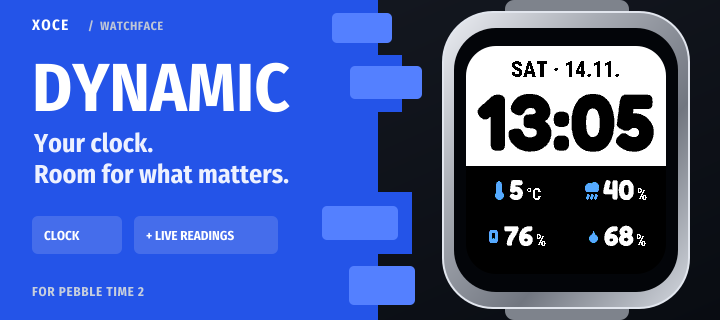

# Dynamic

A watchface for **Pebble Time 2 and Round 2** with an animated Fredoka clock, configurable readings and compatible activities.



[Artwork and native-capture provenance](store/artwork-provenance.json).

<a name="download"></a>

## Install Dynamic 1.0.2

- [View in Pebble Store](https://apps.repebble.com/5db601a9303a4eb7baa90331)
- [Download the matching PBW](https://github.com/xefensor/pebble-watchface-dynamic/releases/download/v1.0.2/Dynamic-1.0.2.pbw)
- [Release notes, source, debug files and checksums](https://github.com/xefensor/pebble-watchface-dynamic/releases/tag/v1.0.2)
- [Illustrated setup and product screenshots](https://xefensor.github.io/xoce/projects/dynamic/)

Version 1.0.2 is published in GitHub Releases and Pebble Store. Open a downloaded PBW with the official Pebble phone app. No separate XOCE app or library installation is needed. [Older releases](https://github.com/xefensor/pebble-watchface-dynamic/releases) retain their original files and evidence; they are not the current installation recommendation.

## Choose the space your readings need

Choose **Columns**, **Stacked rows** or **Four when idle**. The idle grid shows four readings, keeping the selected pair when an activity or Timeline Peek needs room. Optional shake switching cycles global Pebble slots 1–2, 3–4 and 5; it is off by default. Split clock/detail colours and optional reading titles keep the layout your own. Text Size affects supporting text while retaining the Fredoka clock design.

These options are included in the published app. Dynamic uses the first two global Complications choices by default, four for the idle grid, or five when shake switching is enabled. Selected providers keep ownership of their units, source permissions and data. [Usage and controls](docs/USAGE.md) · [Current UI](docs/UI.md).

## Keep a countdown on your clock

Start a countdown in the separate Timer app, then return to Dynamic. In Dynamic settings choose **Activities**, enable **Show activity plugins**, show Timer in **Activity priority**, and save. Use **Reorder** and **Done** to choose its place in the order.

Timer owns the countdown, saved timers and alarm. Open Timer to pause, resume or finish it. Open Activity can add an optional Quick Launch shortcut back; it opens the associated app rather than a particular saved timer.

Sharing needs plugin support in the official Pebble phone app, the selected sources’ permissions and a connected phone. Built-in music and notification integration requires Android. Clock and date continue without a phone. [Step-by-step activity setup](https://xefensor.github.io/xoce/docs/pebble/setup/#illustrated-first-setup).

<a name="compatibility"></a>
<a name="setup-and-use"></a>

## Compatibility, settings and privacy

The published native targets are **Time 2 / Emery, 200×228**, and **Round 2 / Gabbro, 260×260**, built with SDK 4.44. Other models, including Duo, are not included.

Phone settings have four categories: **Layout & complications**, **Colours**, **Activities**, and **More & help**. They share one draft and Save/Discard bar. **✓ Saved** confirms phone persistence; the separate watch status confirms application on the watch. Manual Day/Night palettes and Follow Quiet Time remain independent from the phone page’s appearance. Follow Pebble appearance uses the last explicit palette because the pinned SDK exposes no supported automatic appearance API.

[Support and troubleshooting](SUPPORT.md) · [Privacy](PRIVACY.md) · [Website guides](https://xefensor.github.io/xoce/docs/).

Screenshots keep their actual capture versions and reuse proof. Portable checks, simulated phone/browser tests, native emulator renders and physical-device results are separate evidence. Publication does not establish physical-watch or live-phone testing.

## Development

Use the pinned Node/Python versions and portable Python dependencies in [CONTRIBUTING](CONTRIBUTING.md). A C99 compiler is needed for portable native tests; SDK 4.44 is additionally needed to build the watch app.

```sh
python3 -m pip install -r requirements-portable.txt
npm ci --ignore-scripts
npm test
# With the pinned SDK selected:
npm run build
npm run check:artifact
```

The exact app-bundled dependencies are Core **0.6.1-dev.1**, Activities **0.4.5** and UI **0.1.3** in `vendor/`. These snapshots are separate from independently published library versions. Build outputs belong under ignored `build/`; published PBWs, archives and historical evidence remain frozen.

[Release procedure](docs/RELEASING.md) · [Current publication record](store/publication.json) · [History](docs/history/index.md).

## Licence

[PolyForm Noncommercial 1.0.0](LICENSE). Preserve bundled third-party notices and attribution. The source is available under these terms; commercial use is restricted.
