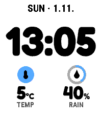
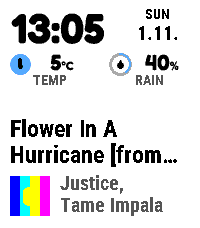
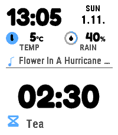

# Dynamic

Main contains the current implementation. [Development](../../CONTRIBUTING.md),
[current maintenance contracts](../../docs/MAINTENANCE.md) and [release policy](../../docs/RELEASING.md)
are the active contributor references. Public downloads and frozen evidence keep
their original versions; a merge to main is not publication.

## Version 0.18.3

- Adopt shared XOCE type roles, icons and phone settings styling while retaining the Fredoka clock and values.
- Combine each complication symbol, value and unit; retain meaningful public qualifiers and source labels while removing redundant weather captions.
- Restore animated layout changes, Peek response and genuine item transitions. Keep accent complication icons, readable values and the expanded activity area.
- Bundle Core 0.5.2 and UI 0.1.1. Preserve v1–v4 readings, ACT3 activity identity, preferences and private-content handling.

GitHub development prerelease for Pebble Time 2 / Emery with SDK 4.33.1.
Validation covers portable tests, packaged runtimes and isolated native emulator
checks. Physical phone/watch and fresh browser testing remain unverified.

[Release validation](../../docs/qa/0.18.3/validation.json) records the exact package and native payload.

Download the [PBW](https://github.com/xefensor/pebble-watchface-dynamic/releases/download/v0.18.3/Dynamic-0.18.3.pbw),
[source](https://github.com/xefensor/pebble-watchface-dynamic/releases/download/v0.18.3/Dynamic-0.18.3-source.zip),
[debug files](https://github.com/xefensor/pebble-watchface-dynamic/releases/download/v0.18.3/Dynamic-0.18.3-debug.zip), and
[checksums](https://github.com/xefensor/pebble-watchface-dynamic/releases/download/v0.18.3/SHA256SUMS.txt).

A Pebble Time 2 watchface with a rounded clock, two complication readings and
notification-style activities. **0.18.3** includes the current shared UI, public
reading labels, complication layout and restored layout/Peek/item animations.
It bundles Core 0.5.2, Activities 0.4.4 and UI 0.1.1.

[Current UI](../../docs/UI.md) describes the type roles, source/privacy boundaries and
intentional motion. [Design review](../../docs/REDESIGN.md) and
[historical 0.18.2 validation](../../docs/qa/0.18.2/VALIDATION.md) retain their original scope.
New release checks use the actual 0.18.3 packages; historical captures are not
relabeled as fresh browser or physical-device evidence.

## Earlier downloads

The previous [Dynamic 0.16.2 prerelease](https://github.com/xefensor/pebble-watchface-dynamic/releases/tag/v0.16.2)
retains its original downloads and source tag. Use the 0.18.3 links above for the
current shared UI. Pebble appstore submission remains separate.

The [previous 0.16.0 release](https://github.com/xefensor/pebble-watchface-dynamic/releases/tag/v0.16.0)
and its artifacts remain available unchanged.

The [previous 0.15.0 release](https://github.com/xefensor/pebble-watchface-dynamic/releases/tag/v0.15.0)
and its artifacts remain available unchanged.

The [previous 0.14.0 release](https://github.com/xefensor/pebble-watchface-dynamic/releases/tag/v0.14.0)
and its artifacts remain available unchanged.

The [earlier 0.8.0 release](https://github.com/xefensor/pebble-watchface-dynamic/releases/tag/v0.8.0)
and its artifacts remain available unchanged.

[All releases](https://github.com/xefensor/pebble-watchface-dynamic/releases) ·
[Changes](../../CHANGELOG.md) · [Release automation](../../docs/GITHUB-RELEASES.md)

These are sideloaded builds for the Pebble plugin preview. Pebble appstore
submission remains held while its preview restriction applies. The user has
reported that the earlier release works on their watch. The current prerelease
has portable, SDK, package and native-emulator checks recorded in
[validation](../../docs/VALIDATION.md). Physical-watch behavior and live phone/provider
delivery remain separate device checks.

Dynamic uses [Pebble Watchface Core](https://github.com/xefensor/pebble-lib-core)
0.5.2-dev.0 for readings on this review branch and [Pebble Activities](https://github.com/xefensor/pebble-lib-activities)
0.4.4 for generic activities and the optional music/notification adapter. Its own UUID, `cc1281f1-3b4d-45b5-b235-6881b1fd8fbd`, allows installation
alongside [Halftone](https://github.com/xefensor/halftone-watchface).

## Before installing

- **Pebble Time 2 only** (`emery`, 200×228). Other Pebble displays are not included.
- Requires the Pebble mobile app's **plugin preview**. Music and notification sources are currently Android-only.
- The two readings follow your shared Pebble complication choices and their available providers.
- The Notifications activity and additional vibration default to Off. They do not replace PebbleOS notifications.
- [Privacy and data](../../PRIVACY.md) · [Support](../../SUPPORT.md) · [Prepared publication materials](../../store/README.md).

## Plugin activities

Dynamic 0.16.2 prefers `activity/summary` schema 4 through pinned
Activities 0.4.4. Sources publish either a standard headline with optional detail,
or media title/artist/artwork. Datums can be text, values or independent clocks.
Plugins supply meaning; Dynamic chooses layout. Existing schema 1/2/3 providers
remain compatible through phone-side adaptation.

Dynamic requests display data and an optional destination app. It does not
request action/entity descriptors or invoke playback and other plugin actions.

The secondary is exactly one static row above the primary, optionally led by a
small symbol. A thin divider separates this row from the primary activity. It
can contain a live countdown, elapsed time, value or text. The
primary expands upward when secondary is absent. Its headline, optional detail
and value labels form a bottom-aligned group immediately above its footer.
Its bottom context can be an instance name, provider identity, or artwork and
artist for media. It is not a mandatory icon-plus-app-name heading. Text never
scrolls or automatically pages.
Complete values and units are preserved; an optional compact view yields when
its essential value cannot fit.

Paused state follows the watch's language. In the compact row it has priority
over optional labels and instance detail. If a complete value and its paused
state cannot fit together, the optional row yields and the primary expands.

In **Content & priority → Activity priority**, drag apps or use their arrow buttons to
reorder and show/hide them. The first eligible activity is primary and the next
secondary. Music and Notifications participate in this same list. Notifications
defaults to Off; when first enabled, its initial priority is first. A saved
Notifications position takes precedence. These are Dynamic's own preferences;
other apps can keep their own order. Timer uses a recognizable
hourglass. Media changes use a short one-time transition; clocks and ordinary
metadata refreshes do not restart motion.

Timer's native app still owns deadlines, saved state and alarms. Its public
phone snapshot can predict a countdown only through its original validity;
reaching zero does not prove native completion or acknowledgement. Paused Timer
visibility keeps its five-minute bound. Acknowledged results disappear when the
owner's update reaches the phone. Other saved sources requiring a trust
annotation are omitted instead of showing them as current without one.

## Open Activity shortcut

Install the separate [**Open Activity 0.1.6** helper](https://github.com/xefensor/pebble-app-open-activity/releases/tag/v0.1.6) and assign that same app to
the desired Quick Launch shortcuts. Its two settings choose one shortcut for
Primary and one for Secondary, from supported taps, holds and combinations.
Dynamic supplies a recent destination pair only after
native presentation confirmation. Missing, expired or non-openable selected
activity makes the helper close; Secondary never silently opens Primary.

The shortcut opens **Dynamic's recent activity**, including if launched from
another watchface shortly afterward. It requires the official phone app's
plugin support and a connection. Current SDK does not expose a strict previous-
watchface guard or cancellation after an app-launch command is sent. Initial
support assumes one connected watch and opens whole apps; it does not select a
particular timer or notification inside them. No firmware or phone-app fork is
required. [Dashboard](https://github.com/xefensor/pebble-app-dashboard) provides
the separate activity overview. Timer Pause/Resume from Dashboard remains deferred.

[Timer 0.12.0](https://github.com/xefensor/pebble-app-timer/releases/tag/v0.12.0)
publishes timer activities and their Timer destination. Install each companion
app separately; Dynamic bundles the Activities library, not the watchapps.

The bundled Dynamic plugin serves `navigation/presented_activities`, instance
`current`, property `hint` as bounded JSON. It stores one overwritten record
containing destination app IDs and freshness/session metadata, with at most a
45-second validity. It does not store song/notification contents, occurrence IDs,
action arguments or history. Source reads cannot renew the record; expired data
is removed on access. See [privacy](../../PRIVACY.md) and
[validation](../../docs/VALIDATION.md) for the scope of current checks.

## Layout

| State | Presentation |
| --- | --- |
| Normal | A shortened localized weekday and numeric date, large rounded clock and two equal reading columns |
| Music/activity | A compact clock and readings, one optional secondary row, primary content and a bottom context footer |
| New notification | An ordinary primary or secondary activity in the saved order, with source app identity and optional message detail |
| Timeline Peek | The face follows Pebble's changing available area, retaining its clock and both readings above the native event panel |

New installs use a white page, black text and a Picton Blue accent. Saved page,
text and accent colors are retained when upgrading. The chosen accent colors
reading symbols, recognized rain-probability gauges and ordinary notification
symbols. Amber identifies low-battery/connection warnings. Secondary text and
artist text use quieter ink, falling back to foreground ink when muting would
lose contrast. Accent graphics also have a visibility fallback after Pebble's
palette rounding. The same composition works with a dark page. An optional
Quiet Time palette uses separately chosen background, text and accent colours
while the watch's Quiet Time is active, then restores the daytime palette at the
next minute refresh. It follows the watch rather than a separate phone schedule.

The clock keeps the same Fredoka shapes while it scales and moves.
Temperature and percent units share that rounded style, with small muted
reading labels. Body text uses bundled Roboto Condensed. Both fonts come
with their SIL Open Font Licenses. The date stays plain, and the layout
shares one canvas without a dot border or text shadows. See
[the design notes](../../docs/NATIVE-STYLE.md) for the reference sources and decisions.

The first two global complication choices keep their left/right positions,
including when one is empty. Precise labels distinguish Temperature, Feels like,
High, Low, Forecast and Phone battery instead of presenting every temperature
as “Now” or every battery as an unspecified device. Neutral numbers, ranges and
times retain the source's labels. Long labels end in a measured ellipsis.

Selected public readings retain their identity through loading, unavailable,
denied, disabled and expired states without retaining a failed value. An
unconfigured slot stays empty. A clock mark means a known observation is at
least an hour old; cache origin or an unknown observation time alone does not
make that claim. Detailed receipt and observation ages remain separate in
settings. Timeline events remain native rather than being duplicated inside
the face.

The compact activity header pairs the time with a prominent numeric date.
Idle and Timeline Peek retain weekday and numeric date on one line. All Music sources use the shared
activity renderer after phone-side adaptation.

Rain-probability percentages can use a 0–100% gauge when the source identifies
them as precipitation data. Other percentages keep their ordinary reading
presentation. Temperatures use a source image when supplied, or a thermometer.

One unified layout gives every installation the same readable hierarchy:

| Element | Idle | Music or message context | Timeline Peek |
| --- | --- | --- | --- |
| Rounded clock | 80px | 42px | 68px |
| Reading values | 34px | 28px | 28px |
| Reading icon circle | 34px | 24px | 24px |

These are drawing sizes, not visible-ink heights. Utility text uses Roboto
Condensed Bold: date 26, reading labels/status 20, static secondary 22 and primary
captions 24. Exact packaged capital/digit ink is 19/14/16/17px respectively.
Music titles use up to three measured 24pt lines alone and two beside a secondary.
The media footer has a 28px optional cover and one 24pt artist line; overflow ends
with an ellipsis. All caption/icon groups center by actual visible ink. The full
primary block sits above its contextual footer with an 8px gap; the footer ends
at y216. Short titles leave unused space above the primary group. No title
continuation or paging timer runs. Paused state and structured detail lead other
footers before optional identity; optional names truncate first. See the
[explicit density choices](../../docs/REDESIGN.md).

Notifications use this same activity composition with or without message text.
As primary they show the sender/title and optional body above app context. As
secondary they stay within one row with app identity and a fitting text prefix.
Music, Timer or another activity can take the other role. Both roles use the
same app-opening metadata regardless of message privacy.
The former Larger text preference and preview size selector are retired;
existing saved choices also use this unified layout.

Short transitions explain changes of priority. A new song title can slide
inside the music area while the clock and readings stay still. Late covers,
artist metadata and notification icons update in place. Media item identity
controls motion; legacy Music uses its received title when no item ID exists.
A new notification activity enters through the same incoming transition;
updates within its burst remain in place. The face
settles after each transition. Turn **Animations** off to disable Dynamic's
own transitions; the layout still follows native Timeline Peek.

Notification sender/title and app identity remain separate. The sender is the
primary heading; a quieter app identity sits in the bottom context footer.
Long app names do not shrink the sender. App-only privacy shows the app name/icon
and uses Notifications as provider context, hiding both sender and message text.
Message previews remain bounded, and privacy clearing takes
priority over completing an outgoing animation.

## Set up

[Settings preview: light](../../docs/images/settings-light.png) · [dark](../../docs/images/settings-dark.png)

1. Enable the Pebble app's plugin preview.
2. Configure slots 1–2 in the phone app's **Complications** settings. These are
   shared Pebble choices and can affect other faces using those slots. Dynamic
   retains their left/right positions and the selected provider's units.
3. Open Dynamic's **Appearance** group. Try the independent Idle, Music, Timer,
   Title only, Message and Timeline examples without changing any content or
   privacy preference. Section shortcuts reach Content and Connection & help
   without changing browser history. The 24 native samples cover six states, two clock
   formats and two themes. They are layout/colour examples, not live data.
4. Choose Light / Dark / Custom, accent and Follow Pebble / 12-hour / 24-hour.
   Returning to Custom restores that session's custom palette. Follow Pebble
   examples use the last OS format reported by the watch; an unknown format is
   explicitly labelled as an illustrative example. The read-only format query
   never changes the watchface's clock preference. Optionally choose a Quiet
   Time palette. Expand **Share colours** for a preset code such as
   `DYN1-FFFFFF-000000-55AAFF`, which shares
   only background, text and accent colours; importing it changes no content,
   privacy, app-filter or vibration preference.
5. In **Content & priority**, check the shared reading summaries and adjacent recovery
   help, then choose plugin activities, reorder or hide activity apps, and choose
   Music and Notifications visibility in the same priority list. The plugin switch
   affects only installed activity plugins and explains disabled rows. Music and
   Notifications remain independent. Enable Notifications in the list to choose
   its details; hiding it retains its privacy choice. A normal summary can
   include a sender or notification title; App-only hides the sender and body.
   Message previews are optional. Viewing a sample does not enable that feature;
   a nearby note identifies disabled examples.
6. For selected notification apps, add exact app names or Android package names
   as individual entries. Entries can be removed and replaced; matching ignores
   case. They are not an installed-app picker and do not verify that the named
   app exists on the phone. **Additional vibration** is Off, Short or Double.
   It uses the same app filter and respects the watch's Quiet Time. PebbleOS
   alerts remain independent, so enabling it can produce a second vibration.
7. The Save area distinguishes unsaved edits from the last delivery. It stays
   fixed in normal phone layouts and joins the page in short/keyboard viewports.
   Focused fields remain above the visible action area.
   Save stores appearance settings on the phone and sends them to the watch.
   Undelivered settings retry automatically after reconnection. **Connection &
   help** shows the source snapshot and expandable technical details.
8. Allow the selected sources' permissions in Pebble. Music uses `ReadMusic`.

Music, animations and compact status indicators default to on. Notification
summaries, message previews and notification vibration default to off. Enable
them explicitly if wanted, and use the app-name filter to limit which
notifications appear.
Notification controls appear only when relevant. Startup and reconnect establish
a fresh baseline so accumulated notifications are not replayed. Native sample
previews are illustrative, not live data; custom recolouring is labelled approximate.
The settings page uses readable phone light/dark colours independently of the
watch palette, including its controls and selected values. Its optional palette
preview can show daytime or Quiet Time colours without changing a watch setting.
Closed colour pickers keep their hidden swatches out of keyboard navigation.
Saved appearance preferences are reapplied on startup and a new native session,
so resetting the watch does not require a dummy settings edit.

Dynamic follows the selected sources' formatted values and units. Weather
comes through Pebble's chosen plugin; this face has no separate HTTP weather
client, provider override or local temperature conversion.

## Dynamic content

A notification activity lasts at most eight seconds in every privacy mode.
An earlier source expiry can shorten it. The first notice sets the burst's
deadline; ongoing updates, including a body or icon arriving later, do not
extend it. Rapid
replacements are coalesced to preserve
a 900ms stable reading interval; privacy/body removal and invalidation clear
immediately rather than waiting for that interval. Paused music releases its
panel after a
five-second grace period, with a pause mark while it remains visible. Music and
phone battery need confirmation at least every two minutes, with a one-minute phone-side refresh. Expiry, disconnection
and privacy changes clear transient content. Music and notification text is
not persisted or logged. The renderer keeps only the temporary RAM snapshots
needed for a bounded transition; clearing private or expired data takes
priority over showing an outgoing animation. A source that removes or fully
redacts a notice also cancels its queued private replacement immediately.

Optional notification vibration occurs once per new allowed burst. Baseline
history, reconnects, retries, artwork and redraws do not trigger it. Quiet Time
suppresses it without saving a delayed vibration for later. The source does
not report whether Pebble's native notification already vibrated, so enabling
Dynamic's vibration can add a second alert to the system's own.

The two selected complication readings can remain cached for up to two hours
from confirmed receipt, capped by an earlier source expiry. Reloading a cache
does not make it fresh again. Receipt time is not the provider's observation
time. Core preserves precise public identity even when a reading expires,
while stale/private value payloads are omitted. Clock and date continue
without the phone.

The built-in Music adapter retains up to 128 UTF-8 bytes per title and artist
before layout. Only the fitting prefix is shown; omitted source bytes cannot
be recovered by the renderer.
Artwork is optional; the core still requests a 40px source target, drawn into
the current 28px footer. Actual detail depends on the source. Obsolete waiting source snapshots are replaced by the
latest update; settings retain ordered delivery. Music is an information
panel: use Pebble's Music app for play/pause and track controls. The current
source does not supply playback position/duration, so there is no invented
music progress bar. A compatible activity can supply a meter only from a real
numeric value and explicit range. Native Timer sharing uses the activity path
described above.

## Languages

Weekdays and phone settings support English, Czech, Slovak, German, French,
Spanish, Italian, Portuguese, Dutch, Polish, Danish, Swedish, Norwegian,
Finnish, Hungarian, Romanian and Turkish. The watch language is preferred,
then the phone language for settings, with English as fallback. Provider text,
names and units remain as supplied. Bundled body fonts include Greek,
Cyrillic and Latin Extended Additional coverage alongside the Latin characters
used by these translations. Characters outside bundled coverage use a visible
missing-character glyph. The UI translations remain the languages listed
above. Language support and font coverage are distinct from physical
verification of every device/language.

## Build and install

Use [CONTRIBUTING](../../CONTRIBUTING.md) for current setup, safe candidate builds and
verification. Release preparation is a separate [explicit workflow](../../docs/RELEASING.md).

## Releases and maintenance

GitHub Actions runs portable checks and validates the committed packages before
publishing a new packaged version from `main`. It uploads exact allowlisted
files and checksums, then verifies them before making the release public. The
workflow does not rebuild the PBW with a different SDK or submit it to Pebble.

Published tags and assets stay frozen. The v0.6.1 tag identifies the tested
artifact commit; later documentation and release-automation updates live on
`main`. A documentation-only update does not require repacking that release.
Prepare new artifacts under a new version when runtime/package contents change.
See [the release guide](../../docs/GITHUB-RELEASES.md) and [maintainer notes](../../AGENTS.md).

## Shared core

The local review candidate pins Core 0.5.2-dev.0 and Activities 0.4.4. Published
downloads retain their original dependency pins. Other watchfaces keep their own
pins; installing Dynamic does not change them.

`vendor/pebble-watchface-core-0.5.2-dev.0.tgz` and
`vendor/pebble-activities-0.4.4.tgz` are committed, version-pinned Pebble packages.
`package-lock.json` records their integrity; `vendor/CORE.json` and
`vendor/ACTIVITIES.json` record upstream/version/checksum provenance. `npm ci`
installs these archives; users install only Dynamic's PBW, not a separate
library app.

Core source handling, expiry, reconnect behavior and notification privacy are
shared with Halftone. Layout, font assets, transitions, settings presentation,
app identity and release artifacts belong to Dynamic. See
[the architecture notes](../../docs/ARCHITECTURE.md) for that boundary and the update
workflow. Updating the core repository alone does not change installed PBWs.

## License

[PolyForm Noncommercial License 1.0.0](../../LICENSE), retaining Xef's attribution.
Use, modification and sharing are permitted for noncommercial purposes under
that license. Commercial use requires separate permission. This is
source-available software rather than an OSI-approved open-source license.

Fredoka and Roboto Condensed use the SIL Open Font License 1.1. Their copyright
notices and licenses accompany the source fonts. The standalone PBW includes those
texts, Clay and bundled-helper notices, and library/Dynamic attribution:

[Fredoka](../../resources/fonts/OFL-Fredoka.txt) and
[Roboto Condensed](../../resources/fonts/OFL-RobotoCondensed.txt). See
[all third-party notices](../../THIRD-PARTY-NOTICES.md). Earlier releases
remain in `dist/`, including 0.3.1. The 0.1 source archive preserves its Fira
Sans Condensed files and font license, while 0.2 uses PebbleOS system fonts.
